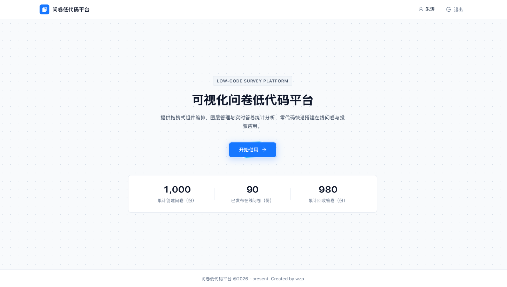
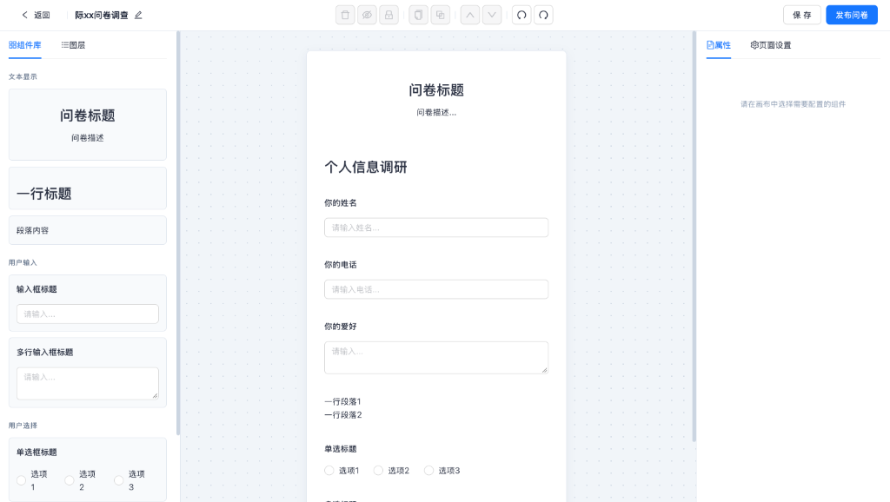

# 问卷低代码平台 (React Low-Code Survey Platform)

面向业务团队的企业级可视化问卷调查与在线表单低代码平台。支持拖拽式表单编排、组件图层管理、撤销/重做（Undo/Redo）、多端问卷投放及实时答卷数据统计分析。

- **在线预览**：[https://react-low-code-tan.vercel.app/](https://react-low-code-tan.vercel.app/)

---

## 界面预览

### 1. 平台首页


### 2. 低代码可视化编辑器工作台


---

## 核心功能特性

### B 端管理与低代码工作台
- **用户认证与权限路由**：支持登录、注册、记住登录状态、基于 Token 的用户信息拉取与路由鉴权守卫。
- **问卷全生命周期管理**：
  - **我的问卷**：支持下拉滚动加载更多、关键字检索、快速星标、一键复制、假删除至回收站。
  - **收藏问卷**：集中管理重要星标问卷，支持分页与搜索。
  - **回收站**：支持批量恢复问卷、批量彻底物理删除。
- **低代码可视化编辑器（三栏 IDE 架构）**：
  - **物料组件库（Schema 驱动）**：内置文本显示（问卷信息、标题、段落）、用户输入（单行输入、多行输入）、用户选择（单选框、多选框）三大类 7 种标准低代码物料组件。
  - **图层管理**：支持组件显隐控制、锁定/解锁、双击重命名及拖拽排序，与画布实时双向同步。
  - **中间画布**：支持 `@dnd-kit` 拖拽排序、点击选中、快捷键操作（`Backspace/Delete` 删除、`Ctrl/Cmd + C/V` 复制粘贴、`↑/↓` 切换选中、`Ctrl/Cmd + Z` 撤销重做、`Ctrl/Cmd + S` 保存）。
  - **属性与页面设置**：右侧面板实时配置选中组件属性，或设置页面级标题、描述、自定义 CSS 与 JS 脚本。
  - **状态历史（Undo / Redo）**：基于 `redux-undo` 实现最多 20 步操作撤销与重做。
- **数据统计与可视化分析**：
  - 自动生成 C 端答卷投放链接与二维码，支持一键复制与新窗口打开。
  - 三栏联动展示问卷组件预览、分页答卷明细表格、以及单选/多选选项比例图表（基于 `Recharts` 饼图与柱状图）。

### C 端答卷端 (`next-client`)
- 基于 **Next.js 14 (SSR)** 服务端渲染，通过 `getServerSideProps` 拉取已发布的问卷配置 Schema 动态渲染表单并收集答卷。

---

## 技术栈

| 模块 | 核心技术 |
| :--- | :--- |
| **B 端主应用** | React 18、TypeScript、React Router v6、Redux Toolkit、Immer、redux-undo |
| **UI 与可视化** | Ant Design 5、SCSS Modules、@dnd-kit（拖拽排序）、Recharts（統計图表） |
| **Hooks 与工具** | ahooks、Axios、Mock.js、nanoid、classnames |
| **C 端答卷端** | Next.js 14、React 18、TypeScript、SCSS |
| **Mock 服务** | Koa 2、koa-router、Mock.js / Vercel Serverless Functions |
| **工程化与质量** | Craco (Webpack 5 分包优化)、Storybook 8、Jest + React Testing Library、ESLint、Prettier、Husky + Commitlint、Docker + Nginx |

---

## 目录结构

```text
react-low-code/
├── api/                        # Vercel Serverless Mock API 入口
├── docs/images/                # 项目预览截图
├── mock-backend/               # 本地 Koa Mock 后端服务 (端口 8000)
│   ├── mockApi/                # 用户、问卷、统计、答卷接口定义
│   └── mockData/               # Mock 数据生成器
├── next-client/                # C 端问卷填写应用 (Next.js SSR, 端口 3000)
├── public/                     # 静态公共资源与 Favicon
├── src/                        # B 端低代码主应用源码 (端口 4000)
│   ├── components/             # 通用组件与 QuestionComponents 低代码物料库
│   ├── constant/               # 全局常量配置
│   ├── hooks/                  # 业务自定义 Hooks (画布快捷键、数据加载、路由守卫等)
│   ├── layouts/                # 顶层布局 (MainLayout / ManageLayout / QuestionLayout)
│   ├── pages/                  # 页面组件 (Home / Login / Register / manage / question)
│   ├── router/                 # 路由配置与懒加载分包
│   ├── services/               # Axios 封装与 API 请求服务
│   ├── store/                  # Redux Toolkit 状态切片 (user / components / pageInfo)
│   └── stories/                # Storybook 组件文档
├── craco.config.js             # Webpack 分包与开发代理配置
├── docker-compose.yml          # 前后端容器编排配置
└── vercel.json                 # Vercel 路由重写与 Serverless 映射配置
```

---

## 快速开始

### 1. 环境要求
- **Node.js** >= 18
- **pnpm**（推荐）或 npm

### 2. 安装依赖

```bash
# 安装主项目依赖
pnpm install

# 安装本地 Mock 后端依赖
cd mock-backend && pnpm install && cd ..
```

### 3. 启动开发环境

```bash
# 同时启动 B 端前端 (http://localhost:4000) 与 Mock 后端 (http://localhost:8000)
pnpm dev
```

如需单独启动 C 端 Next.js 答卷端：

```bash
cd next-client
pnpm install
pnpm dev
```

---

## 常用脚本命令

| 命令 | 说明 |
| :--- | :--- |
| `pnpm dev` | 并行启动 B 端前端开发服务器与 Koa Mock 后端服务 |
| `pnpm start` | 仅启动 B 端前端开发服务器（端口 `4000`） |
| `pnpm run mockbe` | 仅启动 Koa Mock 后端服务（端口 `8000`） |
| `pnpm run build` | 执行生产环境打包与代码分割优化 |
| `pnpm test` | 运行单元测试 |
| `pnpm run lint` | 执行 ESLint 代码检查 |
| `pnpm run format` | 使用 Prettier 格式化源码 |
| `pnpm run storybook` | 启动 Storybook 组件文档（端口 `6006`） |
| `pnpm run analyze` | 使用 `source-map-explorer` 分析生产构建包体积 |
